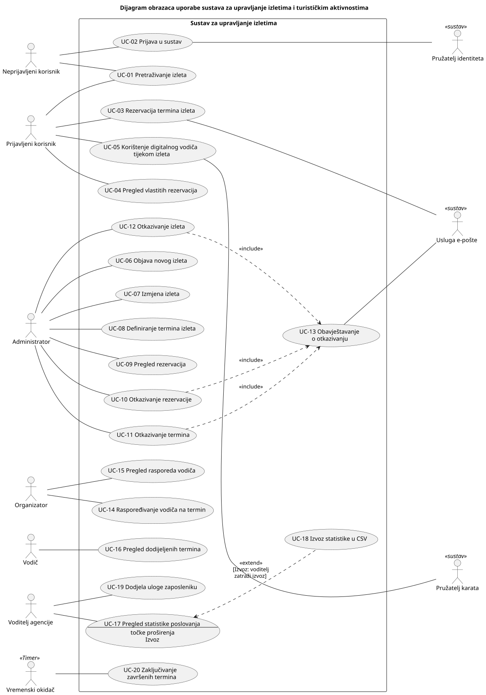

# 3. Obrasci uporabe

**Cilj:** Prikazati glavne interakcije između aktera aplikacije i sustava. Opisati kako akter ostvaruje cilj i što se događa kada važan korak ne uspije. Interakcije se temelje na odobrenim zahtjevima iz poglavlja 2 i ažuriraju se kako se aplikacija razvija.

## 3.1 Dijagram obrazaca uporabe

**Cilj:** Prikazati granicu sustava, relevantne aktere i njihove glavne ciljeve u preglednom UML dijagramu obrazaca uporabe.

**Slika 3.1. Dijagram obrazaca uporabe sustava za upravljanje izletima i turističkim aktivnostima**

**PlantUML izvor:** [izvor](./puml/skicaSustava.puml)

**Provjera dijagrama:**

- **Primarni akteri** (lijevo) su uloge iz odjeljka 2.3 koje izravno komuniciraju s aplikacijom: neprijavljeni korisnik, prijavljeni korisnik (turist), administrator, organizator, vodič i voditelj agencije. Vremenski okidač (A-09) pokreće automatsko zaključivanje završenih termina (UC-20).
- **Sekundarni akteri** (desno) su vanjski sustavi koji sudjeluju u ostvarenju cilja:
  - pružatelj identiteta provodi autentikaciju u UC-02;
  - usluga e-pošte dostavlja potvrde (UC-03) i obavijesti o otkazivanju (UC-13);
  - pružatelj karata isporučuje kartografsku podlogu u UC-05.

  Tehnički detalji integracije pripadaju arhitekturnoj dokumentaciji.

- Turistička agencija (D-01) je dionik, a ne akter. Ona sudjeluje preko uloga A-03 do A-06.
- **«include»:** UC-13 Obavještavanje o otkazivanju obvezno je i zajedničko ponašanje triju obrazaca otkazivanja (UC-10, UC-11, UC-12). Zato nema vlastitu vezu s ljudskim akterom.
- **«extend»:** UC-18 Izvoz statistike u CSV neobvezno proširuje UC-17 na točki proširenja „Izvoz”, uz uvjet da voditelj zatraži izvoz. UC-17 je potpun i bez izvoza.
- Pogreške i alternative opisane su u specifikacijama (3.2), a ne kao «extend».

Dijagram nije podijeljen jer je čitljiv kao cjelina. Ciljevi su grupirani prema akterima od vrha prema dnu.

## 3.2 Specifikacije obrazaca uporabe

**Cilj:** Za svaki obrazac uporabe iz dijagrama objasniti cilj aktera, uobičajenu interakciju s aplikacijom i važne alternative.

Pravila BR-xx i otvorena pitanja Q-xx definirana su u odjeljku 2.4. Gdje ponašanje još nije odlučeno, to je izričito navedeno; privremena pretpostavka tima označena je kao _prijedlog_.

### UC-01: Pretraživanje izleta

| Element specifikacije             | Opis                                                                                                                                                                                                                                                                                                                                                                                                                                                                                                                                                                                                                     |
| :-------------------------------- | :----------------------------------------------------------------------------------------------------------------------------------------------------------------------------------------------------------------------------------------------------------------------------------------------------------------------------------------------------------------------------------------------------------------------------------------------------------------------------------------------------------------------------------------------------------------------------------------------------------------------- |
| **Primarni akter**                | Neprijavljeni korisnik (A-01), Prijavljeni korisnik (A-02)                                                                                                                                                                                                                                                                                                                                                                                                                                                                                                                                                               |
| **Povezani zahtjevi**             | FR-1                                                                                                                                                                                                                                                                                                                                                                                                                                                                                                                                                                                                                     |
| **Preduvjeti**                    | Nema; pretraživanje je dostupno bez prijave.                                                                                                                                                                                                                                                                                                                                                                                                                                                                                                                                                                             |
| **Glavni uspješni tok**           | 1. Korisnik otvara ponudu izleta; aplikacija prikazuje izlete koji nisu otkazani, poredane prema najranijem budućem terminu. 2. Korisnik zadaje jedan ili više kriterija: raspon datuma, lokaciju, kategoriju aktivnosti, raspon trajanja, raspon cijene, broj osoba. 3. Aplikacija prikazuje samo izlete koji zadovoljavaju sve kriterije, s nazivom, kategorijom, lokacijom, trajanjem, cijenom i budućim terminima s brojem slobodnih mjesta. 4. Korisnik odabire izlet; aplikacija prikazuje detalje: opis, mjesto polaska, dodatne usluge s cijenama, znamenitosti i buduće termine sa slobodnim mjestima. |
| **Alternativni tokovi / Iznimke** | **2a — Nevaljan raspon:** Donja granica raspona veća je od gornje. Aplikacija označava kriterij kao pogrešan i ne mijenja prikazane rezultate. **3a — Nema rezultata:** Aplikacija prikazuje poruku da nema izleta za zadane kriterije i zadržava kriterije radi izmjene. **4a — Popunjen termin:** Termin bez slobodnih mjesta prikazuje se kao „popunjen” i ne nudi se za rezervaciju.                                                                                                                                                                                                                           |
| **Posljedice (ishod)**            | Korisnik vidi odgovarajuće izlete i njihove detalje; stanje sustava se ne mijenja. Prijavljeni korisnik iz detalja može pokrenuti UC-03.                                                                                                                                                                                                                                                                                                                                                                                                                                                                                 |

### UC-02: Prijava u sustav

| Element specifikacije             | Opis                                                                                                                                                                                                                                                                                                                                                                                                                                                                                                                                                                                                                            |
| :-------------------------------- | :------------------------------------------------------------------------------------------------------------------------------------------------------------------------------------------------------------------------------------------------------------------------------------------------------------------------------------------------------------------------------------------------------------------------------------------------------------------------------------------------------------------------------------------------------------------------------------------------------------------------------ |
| **Primarni akter**                | Neprijavljeni korisnik (A-01), uključujući zaposlenike prije prijave; sekundarni: Pružatelj identiteta (A-07)                                                                                                                                                                                                                                                                                                                                                                                                                                                                                                                   |
| **Povezani zahtjevi**             | FR-25, FR-26, FR-27                                                                                                                                                                                                                                                                                                                                                                                                                                                                                                                                                                                                             |
| **Preduvjeti**                    | Korisnik nije prijavljen.                                                                                                                                                                                                                                                                                                                                                                                                                                                                                                                                                                                                       |
| **Glavni uspješni tok**           | 1. Korisnik odabire prijavu i pružatelja identiteta. 2. Aplikacija preusmjerava korisnika pružatelju identiteta. 3. Korisnik se autentificira kod pružatelja i odobrava dijeljenje imena, prezimena i adrese e-pošte. 4. Pružatelj vraća potvrdu identiteta s imenom, prezimenom, adresom e-pošte i podatkom o tome je li adresa provjerena. 5. Aplikacija pronalazi račun povezan s tim identitetom; ako ga nema i ne postoji račun s istom adresom, kreira račun bez uloge. 6. Aplikacija uspostavlja sjednicu, prikazuje funkcije dostupne ulozi korisnika i vraća ga na stranicu s koje je pokrenuo prijavu. |
| **Alternativni tokovi / Iznimke** | **2a — Pružatelj nedostupan:** Aplikacija javlja da prijava trenutačno nije moguća; korisnik ostaje neprijavljen. **3a — Odustajanje ili neuspjela autentikacija:** Korisnik ostaje neprijavljen, a radnje za prijavljene korisnike ostaju nedostupne. **4a — Nedostaje adresa e-pošte:** Aplikacija odbija prijavu uz objašnjenje. **5a — Isti provjereni e-mail kod drugog pružatelja:** Postoji račun s istom adresom, a pružatelj potvrđuje da je adresa provjerena. Aplikacija povezuje identitet s postojećim računom i ne stvara novi.                                                                          |
| **Posljedice (ishod)**            | Korisnik je prijavljen s ovlastima svoje uloge, koje poslužitelj provjerava pri svakom zahtjevu. Lozinke se ne pohranjuju (C-02).                                                                                                                                                                                                                                                                                                                                                                                                                                                                                               |

### UC-03: Rezervacija termina izleta

| Element specifikacije             | Opis                                                                                                                                                                                                                                                                                                                                                                                                                                                                                                                                                                                                                                                                                                                                                                                                                                                                                                                                                                                                                                                                                                                                                                        |
| :-------------------------------- | :-------------------------------------------------------------------------------------------------------------------------------------------------------------------------------------------------------------------------------------------------------------------------------------------------------------------------------------------------------------------------------------------------------------------------------------------------------------------------------------------------------------------------------------------------------------------------------------------------------------------------------------------------------------------------------------------------------------------------------------------------------------------------------------------------------------------------------------------------------------------------------------------------------------------------------------------------------------------------------------------------------------------------------------------------------------------------------------------------------------------------------------------------------------------------- |
| **Primarni akter**                | Prijavljeni korisnik (A-02); sekundarni: Usluga e-pošte (A-08)                                                                                                                                                                                                                                                                                                                                                                                                                                                                                                                                                                                                                                                                                                                                                                                                                                                                                                                                                                                                                                                                                                              |
| **Povezani zahtjevi**             | FR-5, FR-6, FR-7, FR-8, FR-9, FR-11                                                                                                                                                                                                                                                                                                                                                                                                                                                                                                                                                                                                                                                                                                                                                                                                                                                                                                                                                                                                                                                                                                                                         |
| **Preduvjeti**                    | Korisnik je prijavljen. Izlet i termin nisu otkazani, a vrijeme polaska još nije nastupilo.                                                                                                                                                                                                                                                                                                                                                                                                                                                                                                                                                                                                                                                                                                                                                                                                                                                                                                                                                                                                                                                                                 |
| **Glavni uspješni tok**           | 1. Korisnik u detaljima izleta odabire termin i zatraži rezervaciju. 2. Aplikacija prikazuje broj slobodnih mjesta, cijenu po osobi i dodatne usluge ponuđene za izlet, s cijenama. 3. Korisnik unosi broj osoba i odabire nijednu, jednu ili više dodatnih usluga; aplikacija prikazuje ukupnu cijenu. 4. Korisnik potvrđuje rezervaciju. 5. Aplikacija ponovno provjerava ima li dovoljno slobodnih mjesta te, kao jednu nedjeljivu operaciju, sprema rezervaciju sa statusom „potvrđena” i smanjuje broj slobodnih mjesta. 6. Aplikacija prikazuje potvrdu s podacima rezervacije. 7. Aplikacija šalje potvrdu e-poštom na adresu korisnika.                                                                                                                                                                                                                                                                                                                                                                                                                                                                                                           |
| **Alternativni tokovi / Iznimke** | **1a — Korisnik nije prijavljen:** Aplikacija nudi prijavu (UC-02). Nakon uspješne prijave tok se nastavlja u koraku 2 za isti termin; inače se rezervacija ne stvara. **3a — Nevaljan broj osoba:** Broj osoba nije cijeli broj veći od nule. Aplikacija objašnjava pogrešku i ostaje na koraku 3. **3b — Previše osoba:** Broj osoba veći je od broja slobodnih mjesta. Aplikacija ne dopušta potvrdu, a korisnik smanjuje broj osoba ili odabire drugi termin. **4a — Odustajanje:** Ništa se ne sprema. **5a — Mjesta su u međuvremenu zauzeta:** Druge rezervacije zauzele su mjesta od koraka 2. Aplikacija odbija rezervaciju, prikazuje novi broj slobodnih mjesta i vraća korisnika na korak 3; broj slobodnih mjesta ostaje nepromijenjen. **5b — Termin u međuvremenu otkazan ili započeo:** Aplikacija odbija rezervaciju uz objašnjenje i vraća korisnika na detalje izleta. **5c — Dodatna usluga više nije ponuđena:** Aplikacija odbija rezervaciju i vraća korisnika na korak 3 s osvježenim popisom usluga. **7a — Slanje e-pošte nije uspjelo:** Rezervacija ostaje potvrđena i vidljiva u UC-04, a pogreška se bilježi u zapisnik. |
| **Posljedice (ishod)**            | Rezervacija je spremljena sa statusom „potvrđena” i ukupnom cijenom utvrđenom u trenutku rezervacije. Broj slobodnih mjesta smanjen je za broj osoba. Ni u kojem toku zbroj osoba u neotkazanim rezervacijama ne premašuje maksimalan broj sudionika.                                                                                                                                                                                                                                                                                                                                                                                                                                                                                                                                                                                                                                                                                                                                                                                                                                                                                                                       |

### UC-04: Pregled vlastitih rezervacija

| Element specifikacije             | Opis                                                                                                                                                                                                                                                                                     |
| :-------------------------------- | :--------------------------------------------------------------------------------------------------------------------------------------------------------------------------------------------------------------------------------------------------------------------------------------- |
| **Primarni akter**                | Prijavljeni korisnik (A-02)                                                                                                                                                                                                                                                              |
| **Povezani zahtjevi**             | FR-10                                                                                                                                                                                                                                                                                    |
| **Preduvjeti**                    | Korisnik je prijavljen.                                                                                                                                                                                                                                                                  |
| **Glavni uspješni tok**           | 1. Korisnik otvara popis svojih rezervacija. 2. Aplikacija prikazuje sve njegove rezervacije s nazivom izleta, datumom i vremenom polaska, mjestom polaska, brojem osoba, dodatnim uslugama, ukupnom cijenom i statusom, nepročitane obavijesti o otkazivanju te, za termin u tijeku. |
| **Alternativni tokovi / Iznimke** | **2a — Tuđa rezervacija:** Izravan zahtjev za rezervaciju drugog korisnika poslužitelj odbija (403).                                                                                                                                                                                     |
| **Posljedice (ishod)**            | Pročitane obavijesti označene su pročitanima; ostalo stanje se ne mijenja.                                                                                                                                                                                                               |

### UC-05: Korištenje digitalnog vodiča tijekom izleta

| Element specifikacije             | Opis                                                                                                                                                                                                                                                                                                                                                                                                                                                                                                                                                                                                                                                                                                                                    |
| :-------------------------------- | :-------------------------------------------------------------------------------------------------------------------------------------------------------------------------------------------------------------------------------------------------------------------------------------------------------------------------------------------------------------------------------------------------------------------------------------------------------------------------------------------------------------------------------------------------------------------------------------------------------------------------------------------------------------------------------------------------------------------------------------- |
| **Primarni akter**                | Prijavljeni korisnik (A-02) na mobilnom uređaju                                                                                                                                                                                                                                                                                                                                                                                                                                                                                                                                                                                                                                                                                         |
| **Povezani zahtjevi**             | FR-19, FR-20                                                                                                                                                                                                                                                                                                                                                                                                                                                                                                                                                                                                                                                                                                                            |
| **Preduvjeti**                    | Korisnik je prijavljen i ima potvrđenu rezervaciju za termin koji je u tijeku. Aplikacija je otvorena preko HTTPS-a.                                                                                                                                                                                                                                                                                                                                                                                                                                                                                                                                                                                                                    |
| **Glavni uspješni tok**           | 1. Korisnik iz popisa rezervacija otvara digitalni vodič za termin u tijeku. 2. Aplikacija provjerava rezervaciju i traži dopuštenje za pristup lokaciji uređaja. 3. Korisnik dopušta pristup lokaciji. 4. Aplikacija prikazuje kartu s oznakama svih znamenitosti izleta i trenutačnim položajem korisnika te ga osvježava pri svakoj promjeni lokacije. 5. Kada je uređaj unutar 100 m od znamenitosti o kojoj korisnik u tom terminu još nije obaviješten, aplikacija prikazuje njezin naziv, kratak opis i značaj. 6. Korisnik zatvara obavijest; koraci 4–6 ponavljaju se dok termin ne završi ili korisnik ne zatvori vodič.                                                                                       |
| **Alternativni tokovi / Iznimke** | **2a — Termin nije u tijeku ili rezervacija nije potvrđena:** Aplikacija ne prikazuje vodič, navodi razlog i, za budući termin, vrijeme polaska. **3a — Odbijen pristup lokaciji:** Ovo vrijedi i kad uređaj nema geolokaciju. Aplikacija prikazuje kartu samo sa znamenitostima i javlja da prikaz položaja i automatske obavijesti nisu dostupni. **4a — Pružatelj karata nedostupan:** Aplikacija prikazuje popis znamenitosti bez kartografske podloge, a obavijesti o blizini i dalje rade  **5a — Više znamenitosti u blizini:** Aplikacija prikazuje obavijest za svaku, najprije za najbližu. **6a — Termin završi dok je vodič otvoren:** Aplikacija prestaje prikazivati obavijesti i javlja da je izlet završio. |
| **Posljedice (ishod)**            | Korisnik je obaviješten o svakoj znamenitosti u čiju je blizinu došao, najviše jednom po znamenitosti u terminu. Položaj korisnika nije pohranjen na poslužitelju.                                                                                                                                                                                                                                                                                                                                                                                                                                                                                                                                                                      |

### UC-06: Objava novog izleta

| Element specifikacije             | Opis                                                                                                                                                                                                                                                                                                                                                                                                                                                                                                                                                                                 |
| :-------------------------------- | :----------------------------------------------------------------------------------------------------------------------------------------------------------------------------------------------------------------------------------------------------------------------------------------------------------------------------------------------------------------------------------------------------------------------------------------------------------------------------------------------------------------------------------------------------------------------------------- |
| **Primarni akter**                | Administrator (A-03)                                                                                                                                                                                                                                                                                                                                                                                                                                                                                                                                                                 |
| **Povezani zahtjevi**             | FR-2                                                                                                                                                                                                                                                                                                                                                                                                                                                                                                                                                                                 |
| **Preduvjeti**                    | Korisnik je prijavljen s ulogom „administrator”.                                                                                                                                                                                                                                                                                                                                                                                                                                                                                                                                     |
| **Glavni uspješni tok**           | 1. Administrator odabire unos novog izleta; aplikacija prikazuje obrazac s popisom kategorija aktivnosti. 2. Administrator unosi naziv, opis, kategoriju, trajanje, lokaciju, mjesto polaska, cijenu po osobi, maksimalan broj sudionika i potreban broj vodiča. 3. Administrator po potrebi dodaje dodatne usluge (naziv, cijena) i znamenitosti (naziv, kratak opis, značaj, koordinate unosom ili odabirom na karti). 4. Administrator sprema izlet; aplikacija provjerava obavezne podatke i njihovu valjanost. 5. Aplikacija sprema izlet i nudi dodavanje termina. |
| **Alternativni tokovi / Iznimke** | **4a — Nedostajući ili nevaljani podaci:** Aplikacija označava pogrešna polja, zadržava unesene podatke i ne sprema izlet. **4b — Nevaljane koordinate znamenitosti:** Aplikacija označava znamenitost i ne sprema izlet. **4c — Odustajanje:** Nakon upozorenja o gubitku unosa ništa se ne sprema.                                                                                                                                                                                                                                                                           |
| **Posljedice (ishod)**            | Izlet je spremljen i vidljiv u pretraživanju.                                                                                                                                                                                                                                                                                                                                                                                                                                                                                                                                        |

### UC-07: Izmjena izleta

| Element specifikacije             | Opis                                                                                                                                                                                                                                                                                                   |
| :-------------------------------- | :----------------------------------------------------------------------------------------------------------------------------------------------------------------------------------------------------------------------------------------------------------------------------------------------------- |
| **Primarni akter**                | Administrator (A-03)                                                                                                                                                                                                                                                                                   |
| **Povezani zahtjevi**             | FR-3                                                                                                                                                                                                                                                                                                   |
| **Preduvjeti**                    | Korisnik ima ulogu „administrator”; izlet postoji i nije otkazan.                                                                                                                                                                                                                                      |
| **Glavni uspješni tok**           | 1. Administrator otvara izlet i mijenja podatke. 2. Administrator sprema izmjene; aplikacija provjerava podatke. 3. Aplikacija sprema izmjene, koje su odmah vidljive u pretraživanju.                                                                                                           |
| **Alternativni tokovi / Iznimke** | **2a — Kapacitet ispod rezerviranog:** Novi maksimalan broj sudionika manji je od broja rezerviranih osoba u nekom budućem terminu. Aplikacija odbija izmjenu i navodi taj termin. **2b — Promjena trajanja uz dodijeljene vodiče:** Onemogućeno mijenjanje trajanja, ako postoji definiran termin. |
| **Posljedice (ishod)**            | Izlet ima nove podatke. Ukupne cijene postojećih rezervacija se ne mijenjaju, a uklonjena dodatna usluga ostaje u postojećim rezervacijama.                                                                                                                                                            |

### UC-08: Definiranje termina izleta

| Element specifikacije             | Opis                                                                                                                                                                                                                                                                                                                                                                                                                                         |
| :-------------------------------- | :------------------------------------------------------------------------------------------------------------------------------------------------------------------------------------------------------------------------------------------------------------------------------------------------------------------------------------------------------------------------------------------------------------------------------------------- |
| **Primarni akter**                | Administrator (A-03)                                                                                                                                                                                                                                                                                                                                                                                                                         |
| **Povezani zahtjevi**             | FR-4                                                                                                                                                                                                                                                                                                                                                                                                                                         |
| **Preduvjeti**                    | Korisnik ima ulogu „administrator”; izlet postoji i nije otkazan.                                                                                                                                                                                                                                                                                                                                                                            |
| **Glavni uspješni tok**           | 1. Administrator na izletu odabire dodavanje termina; aplikacija prikazuje postojeće termine sa slobodnim mjestima i dodijeljenim vodičima. 2. Administrator unosi datum i vrijeme polaska jednog ili više termina. 3. Aplikacija provjerava da je svako vrijeme polaska u budućnosti i da izlet nema termin s istim vremenom polaska. 4. Aplikacija sprema termine s brojem slobodnih mjesta jednakim maksimalnom broju sudionika. |
| **Alternativni tokovi / Iznimke** | **3a — Vrijeme polaska u prošlosti:** Aplikacija označava termin i ne sprema nijedan termin iz tog unosa. **3b — Dvostruki termin:** Isto kao 3a.                                                                                                                                                                                                                                                                                         |
| **Posljedice (ishod)**            | Novi termini su dostupni za rezervaciju i dodjelu vodiča.                                                                                                                                                                                                                                                                                                                                                                                    |

### UC-09: Pregled rezervacija

| Element specifikacije             | Opis                                                                                                                                                                                                  |
| :-------------------------------- | :---------------------------------------------------------------------------------------------------------------------------------------------------------------------------------------------------- |
| **Primarni akter**                | Administrator (A-03)                                                                                                                                                                                  |
| **Povezani zahtjevi**             | FR-12                                                                                                                                                                                                 |
| **Preduvjeti**                    | Korisnik ima ulogu „administrator”.                                                                                                                                                                   |
| **Glavni uspješni tok**           | 1. Administrator zadaje filtre (izlet, termin, status) i/ili pojam za pretraživanje (ime ili adresa e-pošte korisnika). 2. Aplikacija prikazuje samo rezervacije koje odgovaraju zadanim uvjetima. |
| **Alternativni tokovi / Iznimke** | **2a — Nema rezultata:** Aplikacija javlja da nema odgovarajućih rezervacija.                                                                                                                         |
| **Posljedice (ishod)**            | Stanje se ne mijenja; iz rezultata se može pokrenuti UC-10.                                                                                                                                           |

### UC-10: Otkazivanje rezervacije

| Element specifikacije             | Opis                                                                                                                                                                                                                                                                                                           |
| :-------------------------------- | :------------------------------------------------------------------------------------------------------------------------------------------------------------------------------------------------------------------------------------------------------------------------------------------------------------- |
| **Primarni akter**                | Administrator (A-03)                                                                                                                                                                                                                                                                                           |
| **Povezani zahtjevi**             | FR-13, FR-7                                                                                                                                                                                                                                                                                                    |
| **Preduvjeti**                    | Korisnik ima ulogu „administrator”; rezervacija ima status „potvrđena”.                                                                                                                                                                                                                                        |
| **Glavni uspješni tok**           | 1. Administrator odabire rezervaciju i zatraži otkazivanje. 2. Aplikacija traži razlog otkazivanja. 3. Administrator unosi razlog i potvrđuje. 4. Aplikacija postavlja status „otkazana” i povećava broj slobodnih mjesta termina za broj osoba u rezervaciji. 5. Aplikacija obavještava korisnika |
| **Alternativni tokovi / Iznimke** | **1a — Rezervacija nije potvrđena:** Rezervacija ima status „realizirana” ili „otkazana”. Radnja nije ponuđena, a izravan zahtjev poslužitelj odbija. **3a — Razlog nije unesen:** Aplikacija ne dopušta potvrdu. **3b — Odustajanje:** Rezervacija ostaje nepromijenjena.                               |
| **Posljedice (ishod)**            | Rezervacija je otkazana, mjesta su oslobođena, a korisnik je obaviješten.                                                                                                                                                                                                                                      |

### UC-11: Otkazivanje termina

| Element specifikacije             | Opis                                                                                                                                                                                                                                                                                                                                                                                                                                                                                         |
| :-------------------------------- | :------------------------------------------------------------------------------------------------------------------------------------------------------------------------------------------------------------------------------------------------------------------------------------------------------------------------------------------------------------------------------------------------------------------------------------------------------------------------------------------- |
| **Primarni akter**                | Administrator (A-03)                                                                                                                                                                                                                                                                                                                                                                                                                                                                         |
| **Povezani zahtjevi**             | FR-29                                                                                                                                                                                                                                                                                                                                                                                                                                                                                        |
| **Preduvjeti**                    | Korisnik ima ulogu „administrator”; termin nije otkazan i vrijeme polaska još nije nastupilo.                                                                                                                                                                                                                                                                                                                                                                                                |
| **Glavni uspješni tok**           | 1. Administrator odabire termin i zatraži otkazivanje. 2. Aplikacija prikazuje koliko potvrđenih rezervacija i osoba otkazivanje obuhvaća i traži razlog. 3. Administrator unosi razlog i potvrđuje. 4. Aplikacija, kao jednu nedjeljivu operaciju, označava termin otkazanim, svim njegovim potvrđenim rezervacijama postavlja status „otkazana” i uklanja dodjele vodiča. 5. Aplikacija za svaku otkazanu rezervaciju izvodi UC-13 i potvrđuje administratoru broj obavijesti. |
| **Alternativni tokovi / Iznimke** | **1a — Polazak je nastupio:** Otkazivanje nije ponuđeno. **3a — Razlog nije unesen:** Aplikacija ne dopušta potvrdu. **3b — Odustajanje:** Ništa se ne mijenja. **4a — Nema potvrđenih rezervacija:** Termin se otkazuje bez obavijesti.                                                                                                                                                                                                                                            |
| **Posljedice (ishod)**            | Termin se više ne nudi za rezervaciju, a pripadne rezervacije su otkazane. Termin je otkazan zajedno sa svim rezervacijama ili nije otkazan uopće. Povrat novca izvan je opsega.                                                                                                                                                                                                                                                                                                             |

### UC-12: Otkazivanje izleta

| Element specifikacije             | Opis                                                                                                                                                                                                                |
| :-------------------------------- | :------------------------------------------------------------------------------------------------------------------------------------------------------------------------------------------------------------------ |
| **Primarni akter**                | Administrator (A-03)                                                                                                                                                                                                |
| **Povezani zahtjevi**             | FR-30                                                                                                                                                                                                               |
| **Preduvjeti**                    | Korisnik ima ulogu „administrator”; izlet nije otkazan.                                                                                                                                                             |
| **Glavni uspješni tok**           | 1. Administrator odabire izlet, zatraži otkazivanje i unosi razlog. 2. Aplikacija otkazuje izlet i sve njegove buduće termine, a njihove potvrđene rezervacije postavlja na „otkazana”, kao u UC-11, koraci 4–5. |
| **Alternativni tokovi / Iznimke** | **1a — Razlog nije unesen:** Aplikacija ne dopušta potvrdu. **2a — Termin u tijeku:** Taj termin se ne otkazuje (_prijedlog_).                                                                                   |
| **Posljedice (ishod)**            | Izlet se ne prikazuje u pretraživanju; prošle rezervacije i statistika ostaju nepromijenjene.                                                                                                                       |

### UC-13: Obavještavanje o otkazivanju

| Element specifikacije             | Opis                                                                                                                                                                                                                                                      |
| :-------------------------------- | :-------------------------------------------------------------------------------------------------------------------------------------------------------------------------------------------------------------------------------------------------------- |
| **Primarni akter**                | Nema; obuhvaćeni obrazac uporabe koji izvode UC-10, UC-11 i UC-12. Sekundarni: Usluga e-pošte (A-08)                                                                                                                                                      |
| **Povezani zahtjevi**             | FR-31                                                                                                                                                                                                                                                     |
| **Preduvjeti**                    | Rezervacija je upravo otkazana i razlog je poznat.                                                                                                                                                                                                        |
| **Glavni uspješni tok**           | 1. Aplikacija sastavlja obavijest s nazivom izleta, datumom i vremenom termina i razlogom otkazivanja. 2. Aplikacija sprema obavijest u aplikaciji za vlasnika rezervacije. 3. Aplikacija šalje obavijest e-poštom na adresu iz korisničkog računa. |
| **Alternativni tokovi / Iznimke** | **3a — Slanje e-pošte nije uspjelo:** Otkazivanje ostaje na snazi, a obavijest u aplikaciji postoji. Pogreška se bilježi u zapisnik.                                                                                                                      |
| **Posljedice (ishod)**            | Korisnik ima obavijest u aplikaciji, a u pravilu i e-poruku.                                                                                                                                                                                              |

### UC-14: Raspoređivanje vodiča na termin

| Element specifikacije             | Opis                                                                                                                                                                                                                                                                                                                                                                                                                                                                       |
| :-------------------------------- | :------------------------------------------------------------------------------------------------------------------------------------------------------------------------------------------------------------------------------------------------------------------------------------------------------------------------------------------------------------------------------------------------------------------------------------------------------------------------- |
| **Primarni akter**                | Organizator (A-04)                                                                                                                                                                                                                                                                                                                                                                                                                                                         |
| **Povezani zahtjevi**             | FR-14, FR-15, FR-16                                                                                                                                                                                                                                                                                                                                                                                                                                                        |
| **Preduvjeti**                    | Korisnik ima ulogu „organizator”; termin nije otkazan i nije završio.                                                                                                                                                                                                                                                                                                                                                                                                      |
| **Glavni uspješni tok**           | 1. Organizator odabire termin izleta. 2. Aplikacija prikazuje vrijeme polaska i završetka, potreban broj vodiča, već dodijeljene vodiče i vodiče koji u tom vremenu nisu zauzeti preklapajućim terminom. 3. Organizator odabire jednog ili više slobodnih vodiča i potvrđuje dodjelu. 4. Aplikacija ponovno provjerava preklapanja i sprema dodjele. 5. Aplikacija prikazuje termin s dodijeljenim vodičima i odnos dodijeljenog i potrebnog broja.            |
| **Alternativni tokovi / Iznimke** | **2a — Nema slobodnih vodiča:** Aplikacija to javlja; postojeće dodjele ostaju. **3a — Uklanjanje vodiča:** Organizator uklanja dodijeljenog vodiča i potvrđuje. Vodič postaje slobodan za to vrijeme, a tok se nastavlja u koraku 5. **4a — Preklapanje nastalo u međuvremenu:** Vodič je u međuvremenu dodijeljen preklapajućem terminu ili više nema ulogu „vodič”. Aplikacija odbija cijelu dodjelu, navodi vodiča i termin u sukobu te se vraća na korak 2.  |
| **Posljedice (ishod)**            | Dodjele su spremljene i vidljive organizatoru (UC-15) i vodiču (UC-16). Nijedan vodič nije dodijeljen dvama preklapajućim terminima.                                                                                                                                                                                                                                                                                                                                       |

### UC-15: Pregled rasporeda vodiča

| Element specifikacije   | Opis                                                                                                                                                                       |
| :---------------------- | :------------------------------------------------------------------------------------------------------------------------------------------------------------------------- |
| **Primarni akter**      | Organizator (A-04)                                                                                                                                                         |
| **Povezani zahtjevi**   | FR-15                                                                                                                                                                      |
| **Preduvjeti**          | Korisnik ima ulogu „organizator”.                                                                                                                                          |
| **Glavni uspješni tok** | 1. Organizator otvara raspored vodiča. 2. Aplikacija prikazuje sve vodiče s njihovim budućim dodijeljenim terminima i ističe termine s upozorenjem „nedovoljno vodiča”. |
| **Posljedice (ishod)**  | Stanje se ne mijenja.                                                                                                                                                      |

### UC-16: Pregled dodijeljenih termina

| Element specifikacije             | Opis                                                                                                                                                                                    |
| :-------------------------------- | :-------------------------------------------------------------------------------------------------------------------------------------------------------------------------------------- |
| **Primarni akter**                | Vodič (A-05)                                                                                                                                                                            |
| **Povezani zahtjevi**             | FR-21                                                                                                                                                                                   |
| **Preduvjeti**                    | Korisnik ima ulogu „vodič”.                                                                                                                                                             |
| **Glavni uspješni tok**           | 1. Vodič otvara svoje termine. 2. Aplikacija prikazuje samo termine kojima je dodijeljen, s nazivom izleta, datumom i vremenom polaska, mjestom polaska i brojem prijavljenih osoba. |
| **Alternativni tokovi / Iznimke** | **2a — Tuđi termin:** Izravan zahtjev za termin drugog vodiča poslužitelj odbija (403).                                                                                                 |
| **Posljedice (ishod)**            | Stanje se ne mijenja.                                                                                                                                                                   |

### UC-17: Pregled statistike poslovanja

| Element specifikacije             | Opis                                                                                                                                                                                                                                                                                                                               |
| :-------------------------------- | :--------------------------------------------------------------------------------------------------------------------------------------------------------------------------------------------------------------------------------------------------------------------------------------------------------------------------------- |
| **Primarni akter**                | Voditelj agencije (A-06)                                                                                                                                                                                                                                                                                                           |
| **Povezani zahtjevi**             | FR-17                                                                                                                                                                                                                                                                                                                              |
| **Preduvjeti**                    | Korisnik ima ulogu „voditelj agencije”.                                                                                                                                                                                                                                                                                            |
| **Glavni uspješni tok**           | 1. Voditelj otvara statistiku; aplikacija predlaže tekući kalendarski mjesec. 2. Voditelj zadaje početni i završni datum razdoblja. 3. Aplikacija prikazuje za razdoblje: broj rezervacija, popunjenost pojedinih izleta, ostvareni prihod, pet najtraženijih kategorija aktivnosti i pet najtraženijih dodatnih usluga.  |
| **Alternativni tokovi / Iznimke** | **2a — Neispravan raspon:** Završni datum je prije početnog. Aplikacija označava pogrešku. **3a — Nema podataka:** Aplikacija prikazuje nule i javlja da u razdoblju nema rezervacija.                                                                                                                                          |
| **Posljedice (ishod)**            | Stanje se ne mijenja.                                                                                                                                                                                                                                                                                                              |

### UC-18: Izvoz statistike u CSV

| Element specifikacije   | Opis                                                                                                                                                           |
| :---------------------- | :------------------------------------------------------------------------------------------------------------------------------------------------------------- |
| **Primarni akter**      | Voditelj agencije (A-06)                                                                                                                                       |
| **Povezani zahtjevi**   | FR-18                                                                                                                                                          |
| **Preduvjeti**          | Statistika za odabrano razdoblje prikazana je (UC-17, korak 3).                                                                                                |
| **Glavni uspješni tok** | 1. Voditelj zatraži izvoz. 2. Aplikacija generira CSV datoteku (UTF-8, zaglavlje stupaca) s istim vrijednostima koje su prikazane i nudi je za preuzimanje. |
| **Posljedice (ishod)**  | Voditelj ima CSV datoteku koja se otvara u programu za proračunske tablice i sadrži iste vrijednosti kao prikaz.                                               |

### UC-19: Dodjela uloge zaposleniku

| Element specifikacije             | Opis                                                                                                                                                                                                                                                                                                                                                                                                                                                                                                                                                                                    |
| :-------------------------------- | :-------------------------------------------------------------------------------------------------------------------------------------------------------------------------------------------------------------------------------------------------------------------------------------------------------------------------------------------------------------------------------------------------------------------------------------------------------------------------------------------------------------------------------------------------------------------------------------- |
| **Primarni akter**                | Voditelj agencije (A-06)                                                                                                                                                                                                                                                                                                                                                                                                                                                                                                                                                                |
| **Povezani zahtjevi**             | FR-22, FR-23, FR-24                                                                                                                                                                                                                                                                                                                                                                                                                                                                                                                                                                     |
| **Preduvjeti**                    | Korisnik ima ulogu „voditelj agencije”. Osoba kojoj se dodjeljuje uloga prijavila se barem jednom (UC-02).                                                                                                                                                                                                                                                                                                                                                                                                                                                                              |
| **Glavni uspješni tok**           | 1. Voditelj otvara popis zaposlenika; aplikacija prikazuje sve korisnike s ulogom „administrator”, „organizator” ili „vodič” s imenom, prezimenom, adresom e-pošte i ulogom. 2. Voditelj unosi adresu e-pošte registriranog korisnika i odabire jednu od tih uloga. 3. Aplikacija provjerava da korisnik postoji i nema ulogu, dodjeljuje ulogu i osvježava popis.                                                                                                                                                                                                                |
| **Alternativni tokovi / Iznimke** | **2a — Promjena uloge:** Voditelj odabire zaposlenika s popisa i drugu ulogu; aplikacija je sprema. **2b — Oduzimanje uloge:** Voditelj oduzima ulogu; zaposlenik postaje korisnik bez uloge i nestaje s popisa. **2c — Vodič s budućim dodjelama:** Mijenja se ili oduzima uloga vodiču koji ima buduće dodjele. Aplikacija upozorava i navodi termine; što se događa s dodjelama nije odlučeno.  **3a — Nepostojeća adresa:** Aplikacija javlja da se osoba najprije mora prijaviti u sustav. **3b — Korisnik već ima ulogu:** Aplikacija upućuje na promjenu uloge (2a). |
| **Posljedice (ishod)**            | Korisnik pri sljedećem zahtjevu ima pristup funkcijama nove uloge, odnosno gubi pristup funkcijama prethodne. Svaki korisnik ima najviše jednu ulogu.                                                                                                                                                                                                                                                                                                                                                                                                                                   |

### UC-20: Zaključivanje završenih termina

| Element specifikacije             | Opis                                                                                                                                                                                                                            |
| :-------------------------------- | :------------------------------------------------------------------------------------------------------------------------------------------------------------------------------------------------------------------------------ |
| **Primarni akter**                | Vremenski okidač (A-09)                                                                                                                                                                                                         |
| **Povezani zahtjevi**             | FR-28                                                                                                                                                                                                                           |
| **Preduvjeti**                    | Nema; obrada se pokreće periodički (_prijedlog_: svakih 15 minuta).                                                                                                                                                             |
| **Glavni uspješni tok**           | 1. Okidač pokreće obradu. 2. Aplikacija pronalazi termine kojima je završetak (polazak + trajanje) nastupio, a imaju rezervacije sa statusom „potvrđena”. 3. Aplikacija tim rezervacijama postavlja status „realizirana”. |
| **Alternativni tokovi / Iznimke** | **3a — Obrada termina nije uspjela:** Promjene tog termina ne spremaju se djelomično; termin se obrađuje pri sljedećem pokretanju.                                                                                              |
| **Posljedice (ishod)**            | Potvrđene rezervacije završenih termina imaju status „realizirana”, a otkazane ostaju „otkazana”.                                                                                                                               |

---

## 3.3 Provjera dosljednosti obrazaca uporabe

**Cilj:** Provjeriti međusobnu usklađenost obrazaca uporabe, aktera, zahtjeva i ispitnih slučajeva. Cjelovito mapiranje održava se isključivo u **[matrici sljedivosti zahtjeva](2-Analiza-zahtjeva.md#26-sljedivost-zahtjeva)**.
