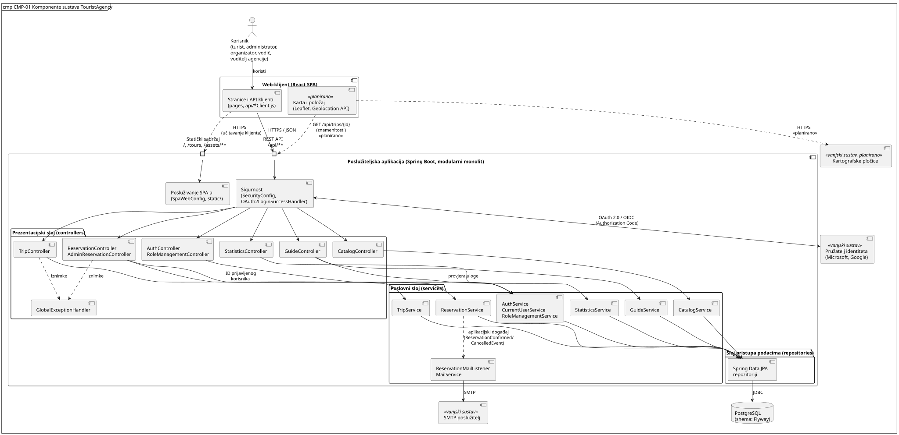
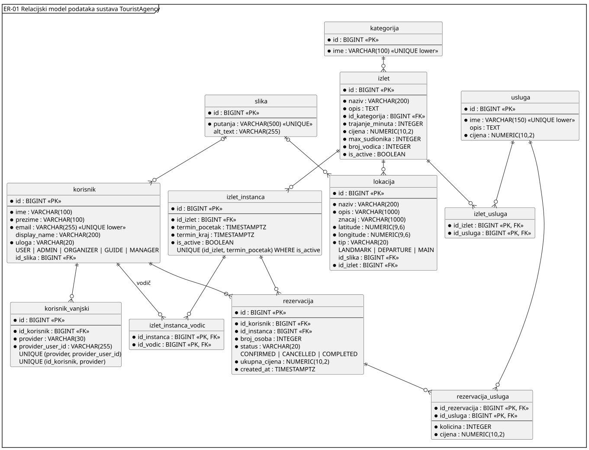
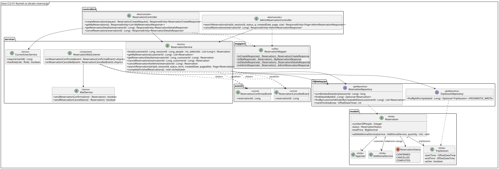
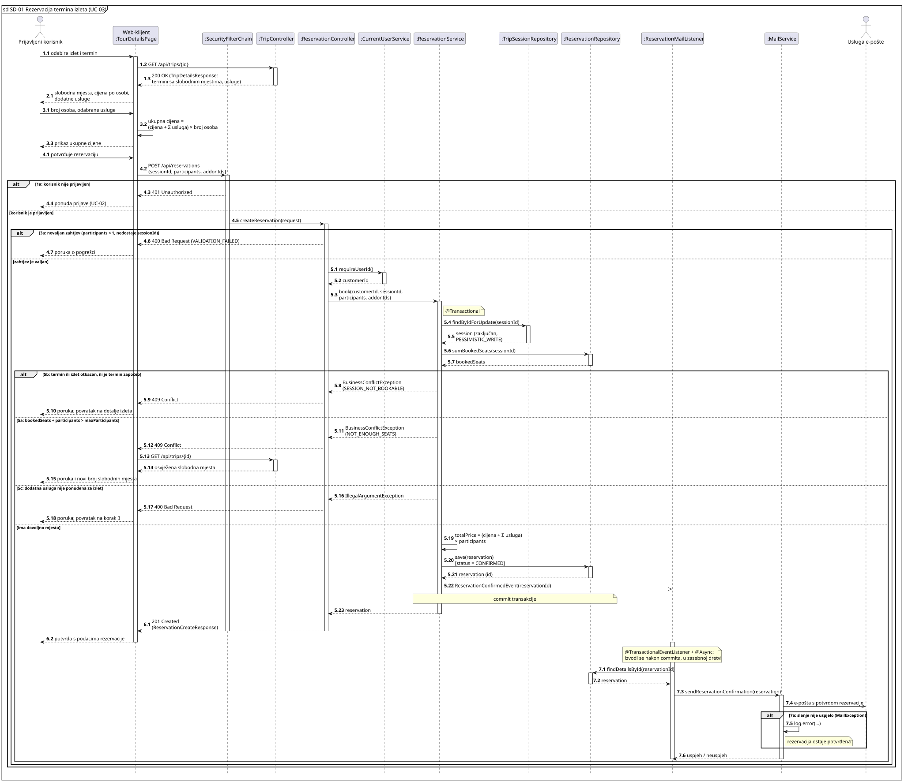
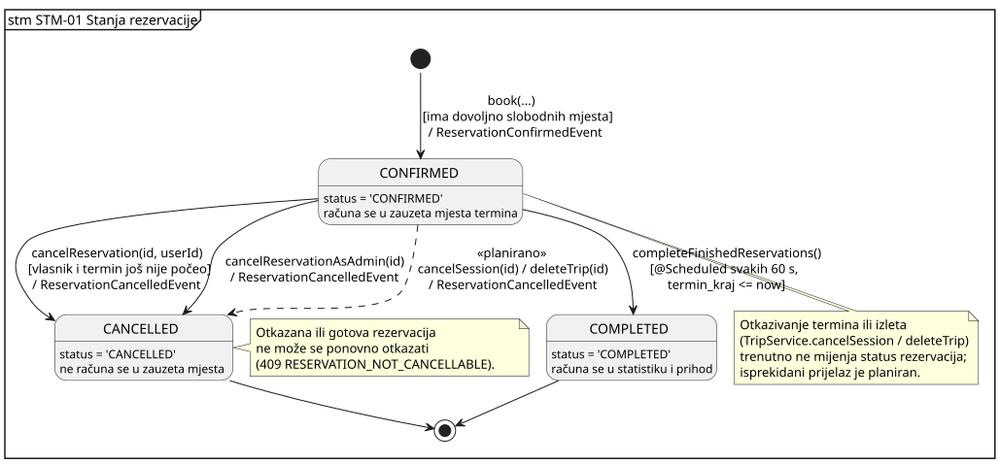

# 4. Arhitektura i oblikovanje

**Cilj:** Definirati arhitekturni stil, dekompoziciju programa na podsustave i module, organizaciju podataka te dinamičko ponašanje tijekom izvođenja. Arhitektura predstavlja temelj za implementaciju i ažurira se pri svakoj važnijoj promjeni projektnih odluka.

| Arhitekturni pogled      | Ključno inženjersko pitanje                           | Primijenjeni model ili dijagram                     |
| :----------------------- | :---------------------------------------------------- | :-------------------------------------------------- |
| **Strategija rješenja**  | Koji stil i temeljne odluke određuju program?         | Tablica odluka (odjeljak 4.1)                       |
| **Struktura podsustava** | Koji su glavni dijelovi i kako komuniciraju?          | Dijagram komponenata (4.2)                          |
| **Model podataka**       | Kako su strukturirani trajni podaci programa?         | Relacijski ER dijagram (4.3.1)                      |
| **Struktura koda**       | Kako su dodijeljene odgovornosti i ključne klase?     | Dijagram razreda — rezervacije (4.3.2)              |
| **Dinamičko ponašanje**  | Kako moduli surađuju pri obradi ključnih transakcija? | Sekvencijski dijagram — rezervacija termina (4.4.1) |
| **Stanja sustava**       | Kako ključni domenski objekt mijenja svoja stanja?    | Dijagram stanja rezervacije (4.4.2)                 |
| **Fizički razmještaj**   | Na kojim se izvršnim čvorovima program izvodi?        | Dijagram razmještaja (poglavlje 6)                  |

---

## 4.1 Ključne arhitekturne odluke

| Odluka                                                                                                   | Razmatrana alternativa                                                                                           | Projektno specifično obrazloženje i kompromis                                                                                                                                                                                                                     |
| -------------------------------------------------------------------------------------------------------- | ---------------------------------------------------------------------------------------------------------------- | ----------------------------------------------------------------------------------------------------------------------------------------------------------------------------------------------------------------------------------------------------------------- |
| Web-klijent u pregledniku i jedna Spring Boot poslužiteljska aplikacija (modularni monolit)              | Zasebno postavljene usluge za izlete, rezervacije i korisnike                                                    | Izleti, termini i rezervacije dijele iste podatke i transakcije (provjera slobodnih mjesta pri rezervaciji). Jedna aplikacija omogućuje jednu lokalnu transakciju i jednostavno postavljanje; kvar aplikacije prekida sve funkcionalnosti istodobno. Vidi ADR-01. |
| Slojevi kontroler → usluga → repozitorij; usluge su konkretni razredi bez zasebnih sučelja               | Sučelje za svaku uslugu (`ITripService`, `IReservationService` …), kako je bilo skicirano u početnom oblikovanju | Svaka usluga ima jednu implementaciju, pa sučelja ne bi donosila zamjenjivost. Ovisnosti se primaju kroz konstruktor, pa se usluge i dalje mogu zamijeniti testnim dvojnicima (Mockito). Ako se pojavi druga implementacija, sučelje se uvodi tada.               |
| Prijava isključivo preko vanjskih OAuth2 pružatelja; identitet u tablici `korisnik_vanjski`              | Vlastita registracija s korisničkim imenom i lozinkom                                                            | Sustav ne pohranjuje lozinke, a jedan korisnički račun može imati više vanjskih identiteta (npr. Google i Microsoft). Kompromis: prijava ovisi o dostupnosti pružatelja identiteta. Vidi ADR-02.                                                                  |
| Slobodna mjesta računaju se iz potvrđenih rezervacija (`izlet.max_sudionika − Σ rezervacija.broj_osoba`) | Denormalizirani brojač slobodnih mjesta na `izlet_instanca`                                                      | Nema dvostrukog izvora istine koji se može razići s rezervacijama. Kompromis: istodobne rezervacije zahtijevaju zaključavanje termina unutar transakcije (vidi 4.7).                                                                                              |
| Slanje e-pošte kroz Spring aplikacijske događaje (`events` + `ReservationMailListener` → `MailService`)  | Zaseban red poruka i proces za slanje e-pošte (Redis/RabbitMQ + worker)                                          | Kreiranje rezervacije ne čeka SMTP poslužitelj i ne ovisi o njegovoj dostupnosti, bez dodatne infrastrukture. Kompromis: nema trajnog reda ni ponovnog pokušaja — poruka se gubi ako slanje ne uspije ili aplikacija padne. Vidi ADR-03.                          |
| Logičko brisanje izleta i termina (`is_active`)                                                          | Fizičko brisanje redaka                                                                                          | Rezervacije ostaju povezane s izletom i terminom pa povijest i statistika ostaju točne. Kompromis: svi upiti za javni prikaz moraju filtrirati neaktivne zapise.                                                                                                  |
| API vraća DTO objekte kroz mapere (`dto`, `mappers`)                                                     | Izravno serijaliziranje JPA entiteta                                                                             | Klijent ne ovisi o shemi baze, nema problema s lijenim učitavanjem i cikličnim vezama, a administratorski prikaz (`AdminReservationResponse`) može sadržavati više podataka od korisničkog. Kompromis: dodatni razredi i kod mapiranja.                           |

## 4.2 Gradivni blokovi i UML dijagram komponenata

**Dijagram komponenata:**

**Slika 4.1. CMP-01 Komponente sustava TouristAgency**

**PlantUML izvor:** [izvor](./puml/4-1-touristagency-system-CMP.puml)

Dijagram je pogled komponenata i konektora: prikazuje logičke dijelove sustava i kako komuniciraju, a konektori su označeni protokolom ili vrstom interakcije (HTTPS/JSON, OAuth 2.0 / OIDC, JDBC, SMTP, aplikacijski događaj). Slojevi su logička organizacija unutar jednog procesa, a ne zasebni poslužitelji; preslikavanje na izvršne čvorove opisuje dijagram razmještaja (DEP-01, poglavlje 6). Element sa stereotipom «planirano» još nije ostvaren.

| Komponenta                                                                                                                     | Odgovornost                                                                                                                                                                                                                 | Razlog za ovu granicu                                                                                                                   |
| ------------------------------------------------------------------------------------------------------------------------------ | --------------------------------------------------------------------------------------------------------------------------------------------------------------------------------------------------------------------------- | --------------------------------------------------------------------------------------------------------------------------------------- |
| Web-klijent                                                                                                                    | Pretraga i prikaz izleta, odabir termina, izračun cijene, rezervacija, pregled vlastitih rezervacija, administratorski prikazi.                                                                                             | Korisnička interakcija odvojena je od poslovnih pravila; klijent komunicira samo preko REST API-ja i ne zna za bazu.                    |
| Sigurnost (`SecurityConfig`, Spring Security)                                                                                  | OAuth2 prijava, sesija, zaštita ruta (`/api/admin/**` samo za administratora, `/api/manager/**` samo za voditelja agencije, `/api/reservations/**` samo za prijavljene). Izmjene izleta trenutno nisu zaštićene (vidi 4.7). | Provjera identiteta i ovlasti izvodi se prije kontrolera, na jednom mjestu, za sve zahtjeve.                                            |
| API i usluga izleta (`TripController`, `TripService`)                                                                          | Pretraga i detalji izleta, CRUD izleta, dodavanje i otkazivanje termina, znamenitosti, izračun cijene.                                                                                                                      | Katalog izleta i termina mijenja organizator/administrator, a čitaju ga svi; neovisan je o tome tko rezervira.                          |
| API i usluga rezervacija (`ReservationController`, `AdminReservationController`, `ReservationService`)                         | Kreiranje rezervacije uz provjeru slobodnih mjesta, pregled i otkazivanje vlastitih rezervacija, administratorska pretraga i otkazivanje.                                                                                   | Najkritičnije poslovno pravilo (nema prebukiranja) ima jedno mjesto odgovornosti; korisnički i administratorski API dijele istu uslugu. |
| Korisnici i uloge (`AuthController`, `AuthService`, `CurrentUserService`, `RoleManagementController`, `RoleManagementService`) | Povezivanje OAuth2 identiteta s računom, podaci o prijavljenom korisniku, dodjela uloga zaposlenicima.                                                                                                                      | `CurrentUserService` je jedini izvor ID-a prijavljenog korisnika, pa ga kontroleri nikad ne čitaju iz tijela zahtjeva.                  |
| Vodiči (`GuideController`, `GuideService`)                                                                                     | Organizator dodjeljuje i uklanja vodiče s termina uz provjeru preklapanja; vodič vidi samo svoje termine.                                                                                                                   | Raspored vodiča je zasebna odgovornost od rezervacija; uloga se provjerava preko `CurrentUserService.requireRole`.                      |
| Statistika (`StatisticsController`, `StatisticsService`)                                                                       | Broj rezervacija, popunjenost, prihod i pet najtraženijih kategorija i usluga za razdoblje; izvoz u CSV.                                                                                                                    | Samo čita podatke i dostupna je samo voditelju agencije (`/api/manager/**`).                                                            |
| Obavijesti e-poštom (`ReservationMailListener`, `MailService`)                                                                 | Reagiranje na događaje rezervacije i slanje e-pošte preko SMTP-a.                                                                                                                                                           | Slanje e-pošte odvojeno je od transakcije rezervacije; kvar SMTP-a ne poništava rezervaciju.                                            |
| Repozitoriji (Spring Data JPA)                                                                                                 | Pristup tablicama i upiti (pretraga, filtriranje, straničenje).                                                                                                                                                             | Usluge ne pišu SQL izravno; upiti su na jednom mjestu.                                                                                  |
| PostgreSQL                                                                                                                     | Trajna pohrana korisnika, izleta, termina, lokacija, usluga i rezervacija.                                                                                                                                                  | Unutar granice sustava jer je baza aplikacije.                                                                                          |
| Vanjski: pružatelj identiteta, SMTP, kartografske pločice                                                                      | Autentikacija, dostava e-pošte, prikaz karte.                                                                                                                                                                               | Usluge trećih strana izvan granice sustava.                                                                                             |

Sve komponente unutar pravokutnika „Poslužiteljska aplikacija” moduli su jedne aplikacije koja se postavlja kao cjelina, a ne zasebne usluge. Paketi u kodu: `controllers`, `services`, `repositories`, `models`, `dto`, `mappers`, `events`, `exceptions`, `config`.

## 4.3 Model podataka i oblikovanje razreda

### 4.3.1 ER dijagram i model podataka

**ER dijagram:**

**Slika 4.2. ER-01 Relacijski model podataka sustava TouristAgency**

**Izvor dijagrama:** [PlantUML izvor](./puml/4-2-touristagency-data-ERD.puml) (izvorna skica izrađena u dbdiagram.io)  
**Implementacija:** shema se stvara Flyway migracijama [`V1__init.sql`](../backend/src/main/resources/db/migration/V1__init.sql) i [`V2__AddSoftDelete.sql`](../backend/src/main/resources/db/migration/V2__AddSoftDelete.sql); JPA entiteti su u paketu `touristAgency.models`, repozitoriji u `touristAgency.repositories`.

Izlet pripada jednoj kategoriji i nudi više dodatnih usluga (`izlet_usluga`). Svaki izlet ima više termina (`izlet_instanca`) i više lokacija (mjesto okupljanja i znamenitosti, razlikuju se stupcem `tip`). Korisnik rezervira određeni termin; rezervacija pamti broj osoba, status i ukupnu cijenu, a odabrane dodatne usluge s količinom i cijenom pohranjuju se u `rezervacija_usluga`. Jedan korisnik može imati više vanjskih identiteta (`korisnik_vanjski`), a vodiči se terminima dodjeljuju preko `izlet_instanca_vodic`.

Odluke vidljive u modelu:

- `rezervacija_usluga.cijena` i `rezervacija.ukupna_cijena` čuvaju cijenu u trenutku rezervacije, pa kasnija promjena cjenika ne mijenja postojeće rezervacije.
- `izlet_instanca` nema stupac slobodnih mjesta; broj slobodnih mjesta izvodi se iz `izlet.max_sudionika` i potvrđenih rezervacija (odluka u 4.1).
- Uloga je pohranjena kao jedan stupac `korisnik.uloga` (jedna uloga po korisniku), a ne kao zasebna tablica uloga.
- Stupci `created_at` i `updated_at` postoje u gotovo svim tablicama i izostavljeni su s dijagrama radi čitljivosti.
- Tablicu `izlet_instanca_vodic` koriste `GuideService` i `GuideController` za dodjelu vodiča terminima i pregled termina vodiča.
- Izleti i termini brišu se logički (`is_active`); jedinstvenost termina (`id_izlet`, `termin_pocetak`) vrijedi samo za aktivne termine.
- Obavijesti unutar aplikacije nemaju tablicu — korisnici se obavještavaju samo e-poštom.

### 4.3.2 Reprezentativni UML dijagram razreda

**Područje:** rezervacija termina i otkazivanje rezervacije.

**Slika 4.3. CLS-01 Razredi za obradu rezervacija**

**PlantUML izvor:** [izvor](./puml/4-3-touristagency-reservation-CD.puml)  
**Referenca na kod:** `controllers/ReservationController.java`, `controllers/AdminReservationController.java`, `services/ReservationService.java`, `services/CurrentUserService.java`, `mappers/ReservationMapper.java`, `services/ReservationMailListener.java`

`ReservationService` jedino je mjesto na kojem se kreira rezervacija i mijenja njezin status — i korisnički (`ReservationController`) i administratorski (`AdminReservationController`) API delegiraju na nju, pa se pravila otkazivanja ne dupliciraju. Kontroleri sadrže samo validaciju ulaza (`@Valid`, granice straničenja), dohvat ID-a prijavljenog korisnika preko `CurrentUserService` i mapiranje u DTO preko `ReservationMapper`. Provjera vlasništva provodi se u usluzi (`getReservationDetails(reservationId, userId)`, `cancelReservation(reservationId, userId)`), a ne u klijentu. `ReservationService` ne poziva `MailService` izravno nego objavljuje događaj; `ReservationMailListener` na njega reagira, pa usluga rezervacija ne ovisi o načinu slanja obavijesti.

Dijagram namjerno izostavlja stupce baze podataka i izlete/kategorije — ER model opisuje pohranjene podatke, a ovaj dijagram dodjelu odgovornosti i operacija.

## 4.4 Ponašanje tijekom izvođenja

### 4.4.1 Reprezentativni UML sekvencijski dijagram

**Scenarij:** UC-03 Rezervacija termina izleta, glavni tijek i alternative 1a, 3a, 5a, 5b, 5c i 7a iz specifikacije u poglavlju 3. Dijagram je na razini oblikovanja (bijela kutija): prikazuje kako web-klijent, kontroleri, usluge i repozitoriji ostvaruju scenarij.

**Slika 4.4. SD-01 Rezervacija termina izleta (UC-03)**

**PlantUML izvor:** [izvor](./puml/4-4-touristagency-reservation-SD.puml)

| Zahtjevi                                 | Obrazac uporabe                  | Sekvencijski dijagram | Ispitivanje                                           |
| ---------------------------------------- | -------------------------------- | --------------------- | ----------------------------------------------------- |
| FR-05, FR-06, FR-07, FR-08, FR-09, FR-11 | UC-03 Rezervacija termina izleta | SD-01                 | `ReservationControllerTest`, `ReservationServiceTest` |

Poruke su numerirane prema koracima specifikacije UC-03: poruke 5.x ostvaruju korak 5 („aplikacija ponovno provjerava slobodna mjesta i sprema rezervaciju”), a uvjeti okvira `alt` nose oznaku odgovarajuće alternative (npr. _5a: bookedSeats + participants > maxParticipants_).

- **Cijena:** klijent ukupnu cijenu za prikaz računa sam iz podataka dohvaćenih s `GET /api/trips/{id}` (poruka 3.2). Konačnu cijenu računa i pohranjuje poslužitelj unutar `book(...)` (5.19), pa klijent ne može poslati vlastitu cijenu.
- **Atomarnost:** zaključavanje termina (`findByIdForUpdate`, `PESSIMISTIC_WRITE`), zbrajanje zauzetih mjesta i spremanje rezervacije izvode se u jednoj transakciji, pa dvije istodobne rezervacije ne mogu prebukirati termin.
- **Potvrda tek nakon pohrane:** odgovor `201 Created` (6.1) šalje se tek nakon što repozitorij vrati spremljenu rezervaciju (5.21) i transakcija završi.
- **Alternative:** neprijavljen korisnik dobiva 401 (1a); nevaljan zahtjev 400 preko `GlobalExceptionHandler` (3a); otkazan ili započet termin i nedovoljno mjesta 409 (5b, 5a), nakon čega klijent ponovno dohvaća slobodna mjesta; usluga koja nije ponuđena za izlet 400 (5c).
- **E-pošta:** `ReservationConfirmedEvent` šalje se asinkrono (otvorena strelica). Listener (`@TransactionalEventListener` + `@Async`) izvodi se nakon commita u zasebnoj dretvi, pa neuspjeh slanja (7a) samo se zapisuje u zapisnik i ne poništava rezervaciju.

### 4.4.2 Reprezentativni UML dijagram stanja

**Vlasnik stanja i razlog odabira:** Rezervacija (`Reservation`, stupac `rezervacija.status`, enum `ReservationStatus`). Status određuje računa li se rezervacija u zauzeta mjesta termina i smije li je korisnik ili administrator otkazati, pa su prijelazi izravno povezani s pravilom o prebukiranju.

**Slika 4.5. STM-01 Stanja rezervacije**

**PlantUML izvor:** [izvor](./puml/4-5-touristagency-reservation-SM.puml)

Prijelazi su zapisani kao _događaj [uvjet] / akcija_. Enum `ReservationStatus` ima vrijednosti `CONFIRMED`, `CANCELLED` i `COMPLETED`, što odgovara ograničenju `chk_rezervacija_status` u bazi (FR-09).

- Rezervacija nastaje izravno u stanju `CONFIRMED` (nema plaćanja ni ručnog odobravanja).
- U `CANCELLED` prelazi kad je otkaže vlasnik, ali samo prije početka termina (`cancelReservation`), ili administrator bez tog ograničenja (`cancelReservationAsAdmin`). Oba prijelaza objavljuju `ReservationCancelledEvent`, pa korisnik dobiva e-poštu (FR-11).
- U `COMPLETED` prelazi periodički zadatak `completeFinishedReservations()` (`@Scheduled`, svakih 60 s) za sve potvrđene rezervacije čiji je `termin_kraj` prošao (FR-22).
- Iz `CANCELLED` i `COMPLETED` nema prijelaza; pokušaj otkazivanja vraća 409 `RESERVATION_NOT_CANCELLABLE` (FR-13).
- Otkazivanje termina ili izleta (`TripService.cancelSession`, `deleteTrip`) trenutno ne mijenja status njegovih rezervacija, što nije u skladu s UC-11 i UC-12 (vidi 4.7).

## 4.5 Zapisi arhitekturnih odluka

| ID     | Datum   | Odluka                                                          | Razmatrana alternativa                            | Obrazloženje i kompromis                                                                                          | Status                                                             |
| ------ | ------- | --------------------------------------------------------------- | ------------------------------------------------- | ----------------------------------------------------------------------------------------------------------------- | ------------------------------------------------------------------ |
| ADR-01 | [datum] | Jedna Spring Boot aplikacija s modulima po domeni               | Zasebne usluge za izlete, rezervacije i korisnike | Jedna lokalna transakcija za rezervaciju i jednostavno postavljanje; kvar aplikacije prekida sve funkcionalnosti. | Prihvaćeno                                                         |
| ADR-02 | [datum] | Prijava samo preko OAuth2 pružatelja, više identiteta po računu | Vlastite lozinke                                  | Bez pohrane lozinki; ovisnost o vanjskom pružatelju.                                                              | Prihvaćeno                                                         |
| ADR-03 | [datum] | E-pošta preko Spring aplikacijskih događaja                     | Red poruka i zaseban worker                       | Bez dodatne infrastrukture; nema ponovnog pokušaja slanja.                                                        | Prihvaćeno (zamjenjuje početnu skicu s `EmailQueue`/`EmailWorker`) |

### ADR-01: Jedna poslužiteljska aplikacija s modulima po domeni

| Polje                  | Zapis odluke                                                                                                                                                                                                                                            |
| ---------------------- | ------------------------------------------------------------------------------------------------------------------------------------------------------------------------------------------------------------------------------------------------------- |
| Kontekst i cilj        | Tim tijekom semestra mora izraditi i postaviti katalog izleta, rezervacije, prijavu i administraciju. Rezervacija mora atomarno provjeriti slobodna mjesta termina i spremiti rezervaciju s dodatnim uslugama.                                          |
| Kriteriji odluke       | Atomarnost rezervacije, mogućnost izrade i postavljanja u roku, jasno razdvojene odgovornosti u kodu.                                                                                                                                                   |
| Razmatrane alternative | **Jedna aplikacija:** moduli (`TripService`, `ReservationService`, `AuthService` …) dijele bazu i transakciju. **Zasebne usluge:** rezervacije bi morale preko mreže pitati uslugu izleta za slobodna mjesta, što zahtijeva distribuiranu koordinaciju. |
| Odluka i obrazloženje  | Jedna Spring Boot aplikacija s paketima po sloju i uslugama po domeni. Rezervacija se izvodi u jednoj `@Transactional` metodi. Prihvaćamo da se aplikacija skalira i postavlja kao cjelina.                                                             |
| Status                 | Prihvaćeno.                                                                                                                                                                                                                                             |

### ADR-02: Prijava samo preko vanjskih OAuth2 pružatelja

| Polje                  | Zapis odluke                                                                                                                                                                                                                                |
| ---------------------- | ------------------------------------------------------------------------------------------------------------------------------------------------------------------------------------------------------------------------------------------- |
| Kontekst i cilj        | Korisnici se moraju prijaviti radi rezervacije, a zaposlenici radi administracije. Tim ne želi odgovornost za pohranu i oporavak lozinki.                                                                                                   |
| Kriteriji odluke       | Sigurnost, jednostavnost za korisnika, mogućnost prijave s više pružatelja na isti račun.                                                                                                                                                   |
| Razmatrane alternative | **Vlastite lozinke:** puna kontrola, ali hashiranje, resetiranje i zaštita od napada. **OAuth2 (Spring Security `oauth2Login`):** pružatelj provjerava identitet, aplikacija pamti samo `provider` i `provider_user_id`.                    |
| Odluka i obrazloženje  | OAuth2 prijava; tablica `korisnik_vanjski` omogućuje više identiteta po računu. Novi korisnik dobiva osnovnu ulogu, a uloge zaposlenika dodjeljuje administrator (`RoleManagementController`). Prijava ne radi ako je pružatelj nedostupan. |
| Status                 | Prihvaćeno.                                                                                                                                                                                                                                 |

### ADR-03: Slanje e-pošte preko aplikacijskih događaja

| Polje                  | Zapis odluke                                                                                                                                                                                                                                                                                                                                                    |
| ---------------------- | --------------------------------------------------------------------------------------------------------------------------------------------------------------------------------------------------------------------------------------------------------------------------------------------------------------------------------------------------------------- |
| Kontekst i cilj        | Korisnik treba dobiti potvrdu rezervacije e-poštom, ali spori ili nedostupni SMTP poslužitelj ne smije usporiti ni poništiti rezervaciju.                                                                                                                                                                                                                       |
| Kriteriji odluke       | Odziv API-ja, rezervacija ostaje valjana i kad e-pošta ne uspije, bez dodatne infrastrukture.                                                                                                                                                                                                                                                                   |
| Razmatrane alternative | **Red poruka i zaseban worker** (početna skica s `EmailQueue`/`EmailWorker`): trajnost i ponovni pokušaji, ali dodatni kontejner i konfiguracija. **Sinkroni poziv `MailService` iz usluge:** najjednostavnije, ali vezuje odziv i ishod transakcije uz SMTP. **Spring događaj + listener:** usluga objavljuje događaj, listener šalje e-poštu nakon spremanja. |
| Odluka i obrazloženje  | `ReservationService` objavljuje događaj (paket `events`), `ReservationMailListener` poziva `MailService`. Listener je označen s `@TransactionalEventListener` (zadana faza `AFTER_COMMIT`) i `@Async`, pa se e-pošta šalje tek nakon commita i u zasebnoj dretvi. Prihvaćamo da se poruka ne šalje ponovno ako slanje ne uspije.                                |
| Status                 | Prihvaćeno.                                                                                                                                                                                                                                                                                                                                                     |

## 4.6 Zajednička pravila oblikovanja

| Aspekt                          | Mehanizam                                       | Pravilo                                                                                                                                                                                                                                                                                                                                       | Mjesto primjene                                                                                                         |
| ------------------------------- | ----------------------------------------------- | --------------------------------------------------------------------------------------------------------------------------------------------------------------------------------------------------------------------------------------------------------------------------------------------------------------------------------------------- | ----------------------------------------------------------------------------------------------------------------------- |
| Sigurnost — autentikacija       | Spring Security OAuth2 login + sesijski kolačić | Svi zaštićeni endpointi zahtijevaju prijavu; `GET /api/auth/me` vraća 401 ako korisnik nije prijavljen.                                                                                                                                                                                                                                       | `config/SecurityConfig`, `AuthController`, `AuthService`                                                                |
| Sigurnost — identitet korisnika | `CurrentUserService.requireUserId()`            | ID korisnika uvijek se uzima iz sigurnosnog konteksta, nikad iz tijela zahtjeva, pa korisnik ne može rezervirati ili otkazati u tuđe ime.                                                                                                                                                                                                     | `ReservationController`, `ReservationService` (provjera vlasništva)                                                     |
| Sigurnost — autorizacija        | Pravila ruta po ulozi                           | `/api/admin/**` dostupan je samo administratoru, `/api/manager/**` samo voditelju agencije, a `/api/reservations/**` samo prijavljenom korisniku; `GuideController` provjerava ulogu u svakoj metodi. Skrivanje gumba u klijentu nije zaštita. Izmjene izleta i termina (`POST/PUT/DELETE /api/trips/**`) trenutno nisu zaštićene (vidi 4.7). | `config/SecurityConfig`                                                                                                 |
| Validacija podataka             | Jakarta Bean Validation (`@Valid`)              | Tijela zahtjeva provjeravaju se prije ulaska u uslugu; granice straničenja (`page ≥ 0`, `1 ≤ size ≤ 100`) provjeravaju se u kontroleru.                                                                                                                                                                                                       | DTO u paketu `dto`, `TripController`, `ReservationController`, `AdminReservationController`, `RoleManagementController` |
| Obrada pogrešaka                | `@RestControllerAdvice`                         | Iznimke iz usluga (paket `exceptions`) pretvaraju se u dosljedne HTTP odgovore (400, 403, 404, 409) na jednom mjestu.                                                                                                                                                                                                                         | `controllers/GlobalExceptionHandler`                                                                                    |
| Transakcije                     | `@Transactional`                                | Provjera slobodnih mjesta i spremanje rezervacije s uslugama izvode se u jednoj transakciji.                                                                                                                                                                                                                                                  | `ReservationService.book`                                                                                               |
| Upravljanje ovisnostima         | Injektiranje kroz konstruktor                   | Kontroleri i usluge primaju ovisnosti kroz konstruktor, bez `@Autowired` na poljima.                                                                                                                                                                                                                                                          | Svi kontroleri i usluge                                                                                                 |
| Granica API-ja                  | DTO + maperi                                    | Entiteti se ne vraćaju klijentu; korisnički i administratorski prikaz rezervacije različiti su DTO-i.                                                                                                                                                                                                                                         | `dto`, `mappers/ReservationMapper`                                                                                      |
| Asinkrone obavijesti            | Aplikacijski događaji                           | Usluge objavljuju događaje, slanje e-pošte odvija se u listeneru.                                                                                                                                                                                                                                                                             | `events`, `ReservationMailListener`, `MailService`                                                                      |

## 4.7 Arhitekturni rizici i tehnički dug

**Tehnički rizici i dug**

| Rizik ili kompromis                                                          | Posljedica                                                                                                                             | Odgovor na rizik                                                                                                                                                                                                                                                                 |
| ---------------------------------------------------------------------------- | -------------------------------------------------------------------------------------------------------------------------------------- | -------------------------------------------------------------------------------------------------------------------------------------------------------------------------------------------------------------------------------------------------------------------------------- |
| Istodobne rezervacije istog termina (slobodna mjesta računaju se zbrajanjem) | Bez zaključavanja dvije transakcije mogu istodobno vidjeti dovoljno mjesta i prebukirati termin.                                       | Riješeno: `book` dohvaća termin s pesimističnim zaključavanjem (`TripSessionRepository.findByIdForUpdate`, `@Lock(PESSIMISTIC_WRITE)`), pa se istodobne rezervacije istog termina izvode jedna za drugom (SD-01). Preostaje automatizirani test s paralelnim zahtjevima (NF-04). |
| E-pošta bez trajnog reda i ponovnog pokušaja                                 | Ako SMTP ne odgovori ili aplikacija padne, korisnik ne dobije potvrdu.                                                                 | Prihvaćeno (ADR-03); rezervacija je vidljiva u „Moje rezervacije”, greška se bilježi u log.                                                                                                                                                                                      |
| `@CrossOrigin(origins = "*")` na `TripController`                            | Bilo koja domena može pozivati API izleta iz preglednika, uključujući metode izmjene.                                                  | Ograničiti CORS na domenu klijenta centralno u `SecurityConfig` i ukloniti anotaciju s kontrolera.                                                                                                                                                                               |
| `GET /api/trips/{id}/landmarks?lat=&lon=` prima položaj korisnika            | Položaj uređaja šalje se na poslužitelj, što je u suprotnosti s početnom namjerom da se položaj obrađuje samo u pregledniku.           | Svjesni kompromis radi jednostavnijeg klijenta; položaj se ne pohranjuje. Alternativa: klijent dohvaća sve znamenitosti i sam računa udaljenost. **[Odlučiti i uskladiti s nefunkcionalnim zahtjevom o privatnosti.]**                                                           |
| Izmjene izleta i termina nisu zaštićene (`anyRequest().permitAll()`)         | Bilo tko, i bez prijave, može stvoriti, izmijeniti ili otkazati izlet ili termin.                                                      | Dodati pravilo u `SecurityConfig` koje za `POST/PUT/DELETE /api/trips/**` traži ulogu administratora, uz test koji očekuje 401/403.                                                                                                                                              |
| Otkazivanje termina ili izleta ne otkazuje njegove rezervacije               | Rezervacije otkazanog termina ostaju `CONFIRMED`, ulaze u statistiku i korisnik ne dobiva e-poštu (odstupanje od UC-11, UC-12, FR-13). | `cancelSession` i `deleteTrip` trebaju otkazati sve potvrđene rezervacije termina i objaviti `ReservationCancelledEvent` za svaku (STM-01).                                                                                                                                      |
| `TestController` u produkcijskom kodu                                        | Nepotrebni endpointi dostupni u postavljenoj aplikaciji.                                                                               | Ukloniti ili uključiti samo u razvojnom profilu (`@Profile("dev")`).                                                                                                                                                                                                             |

**Poslovni ili domenski rizici**

| Rizik                                           | Posljedica                                                                            | Odgovor na rizik                                                                            |
| ----------------------------------------------- | ------------------------------------------------------------------------------------- | ------------------------------------------------------------------------------------------- |
| Jedna instanca aplikacije obrađuje sve zahtjeve | Kvar poslužitelja privremeno onemogućuje pregled izleta i rezervacije.                | Prihvaćeno u okviru ograničenja projekta; nema automatskog prebacivanja na pričuvni sustav. |
| Nedostupnost pružatelja identiteta              | Korisnici se ne mogu prijaviti ni rezervirati, iako je katalog izleta javno dostupan. | Prihvaćeno (ADR-02); podržano je više pružatelja.                                           |
| Nedostupnost kartografske usluge                | Karta se ne prikazuje.                                                                | Znamenitosti i mjesto okupljanja ostaju dostupni kao tekst u detaljima izleta.              |

---

> **Završna provjera:** Usporediti dijagrame s kodom (posebno sve oznake **[PROVJERITI]**), ažurirati zastarjele opise i objasniti preostale razlike.
